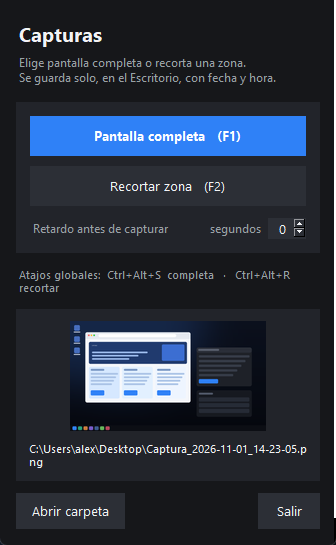
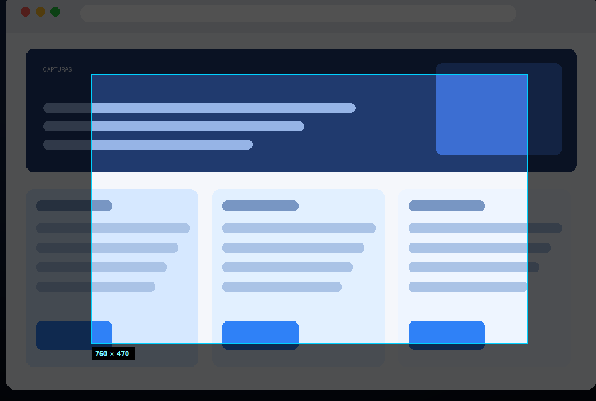

# CAPTURAS

Capturas de pantalla en **Windows, macOS y Linux**: pantalla completa o zona
recortada, guardadas solas en el Escritorio con la **fecha y la hora** en el
nombre. Sin nubes, sin cuentas y sin ventanas de configuración.



- **Pantalla completa** (todos los monitores de una vez, con F1 o
  `Ctrl+Alt+S`).
- **Recorte de zona** sobre una captura congelada: el fondo se oscurece, la
  zona elegida se ve nítida y el tamaño en píxeles se actualiza mientras
  arrastras.
- **Guardado automático**: `Captura_2026-11-01_14-23-05.png` aparece en el
  Escritorio. Nunca sobrescribe: si coincide el segundo añade `_2`, `_3`…
- **Retardo** de 0 a 10 s, para abrir un menú antes de disparar.
- **Atajos globales** en Windows: funcionan aunque la app esté minimizada.
- **Ligero**: Python + Pillow + tkinter, sin dependencias exóticas.

| Sistema | Estado |
|---|---|
| **Windows 10/11** | ✅ Nativo: multimonitor, DPI real y atajos globales |
| **macOS 12+** | ✅ Captura y recorte (pide permiso de Grabación de pantalla) |
| **Linux** | ✅ X11 · Wayland con `grim` o `gnome-screenshot` |

## Descargar

En **[Releases](https://github.com/euphoriabot7/capturas/releases/latest)** están
los ejecutables de Windows, macOS y Linux que compila el CI:

| Archivo | Sistema |
|---|---|
| `Capturas.exe` | Windows 10/11 (sin instalar Python) |
| `Capturas-macos` | macOS 12+ |
| `Capturas-linux` | Linux x86_64 |

Si macOS se niega a abrirlo por no estar firmado:

```bash
xattr -dr com.apple.quarantine Capturas-macos
chmod +x Capturas-macos
```

---

## 1. Probar desde el código fuente

### Windows

Doble clic en **`run.bat`** (la primera vez crea el entorno virtual e instala
Pillow), o a mano:

```bat
python -m venv .venv
.venv\Scripts\python.exe -m pip install -r requirements.txt
.venv\Scripts\pythonw.exe capturas.py
```

> `pythonw.exe` abre la app sin consola detrás.

### macOS / Linux

```bash
./run.sh
```

O a mano:

```bash
python3 -m venv .venv
source .venv/bin/activate
pip install -r requirements.txt
python capturas.py
```

En Linux con Wayland instala antes `grim` (recomendado) o `gnome-screenshot`:

```bash
sudo apt install grim          # Debian/Ubuntu
sudo pacman -S grim            # Arch
```

---

## 2. Uso

| Acción | Windows | macOS / Linux |
|---|---|---|
| Pantalla completa | **F1** · `Ctrl+Alt+S` | **F1** (ventana activa) |
| Recortar zona | **F2** · `Ctrl+Alt+R` | **F2** (ventana activa) |
| Cancelar el recorte | **Esc** o clic derecho | **Esc** |
| Confirmar el recorte | **Enter** (o suelta el ratón) | **Enter** |
| Retardo | campo “Retardo antes de capturar” | igual |

**Recorte en 3 pasos:** pulsa *Recortar zona*, arrastra sobre la zona que
quieras (verás el tamaño real en píxeles) y suelta el botón. Se guarda al
instante y la miniatura aparece en la ventana.



---

## 3. Dónde se guardan

En el **Escritorio real** del sistema:

- Windows: respeta la carpeta aunque esté redirigida a OneDrive.
- Linux: respeta `XDG_DESKTOP_DIR` (por ejemplo `~/Escritorio`).
- macOS: `~/Desktop`.

Formato del nombre:

```
Captura_2026-11-01_14-23-05.png
        └─ fecha ─┘ └─ hora ─┘
```

Si necesitas otra carpeta o prefijo, usa la línea de comandos:

```bash
python capturas.py --outdir "D:/Capturas" --prefix "Trabajo"
```

---

## 4. Acceso directo / lanzador

### Windows

```powershell
powershell -ExecutionPolicy Bypass -File install-windows.ps1
```

Crea **Capturas** en el Escritorio con su icono, apuntando a `pythonw.exe`
(sin consola). Para un único `.exe` sin Python instalado, compila con
`build.bat`.

### Linux

```bash
./install-linux.sh
```

Añade `Capturas` al menú de aplicaciones. Si quieres un atajo global, asígnalo
en *Ajustes → Teclado → Atajos personalizados* con el comando:

```bash
/path/al/repo/.venv/bin/python /path/al/repo/capturas.py --full
```

### macOS

Abre `./run.sh` y, si quieres tenerlo a mano, añade el script al Dock o crea
un lanzador con Automator. Los atajos globales del sistema se pueden apuntar a
`capturas.py --full` desde *Atajos → Atajos de teclado*.

---

## 5. Línea de comandos

```bash
python capturas.py --full            # captura todo y sale (sin ventana)
python capturas.py --crop            # abre directamente el recorte
python capturas.py --delay 3         # 3 segundos antes de capturar
python capturas.py --outdir ~/Imgs   # cambia la carpeta destino
python capturas.py --prefix Foto     # Foto_2026-11-01_14-23-05.png
python capturas.py --version
```

| Opción | Qué hace |
|---|---|
| `--full` | Captura todo el escritorio, guarda y termina |
| `--crop` | Abre la ventana con la capa de recorte ya activa |
| `--delay SEG` | Espera antes de capturar (acepta decimales) |
| `--outdir CARPETA` | Carpeta destino (por defecto el Escritorio) |
| `--prefix TEXTO` | Prefijo del archivo (por defecto `Captura`) |

`--full` imprime en stdout la ruta del archivo generado, así que se puede usar
en scripts o tareas programadas.

---

## 6. Compilar un ejecutable

**Windows** — doble clic en **`build.bat`** → `dist\Capturas.exe`

**macOS / Linux** — `./build.sh` → `dist/Capturas`

Comando exacto de PyInstaller (Windows):

```bat
pyinstaller --noconfirm --clean --onefile --windowed ^
  --name "Capturas" ^
  --icon "icon.ico" ^
  --add-data "icon.ico;." ^
  --add-data "icon.png;." ^
  capturas.py
```

> En macOS/Linux el separador de `--add-data` es `:` en vez de `;`.

---

## 7. Notas por sistema

**Windows**
- La captura y la capa de recorte cubren **todo el escritorio virtual**
  (todos los monitores), a resolución real aunque Windows esté al 125 % o 150 %.
- Los atajos `Ctrl+Alt+S` / `Ctrl+Alt+R` son globales (registrados con la API
  de Windows en un hilo aparte para que el bucle de Tk no se los coma).

**macOS**
- La primera vez macOS pedirá permiso: *Ajustes del Sistema → Privacidad y
  seguridad → Grabación de pantalla*. Sin él la captura sale en blanco.
- En pantallas Retina la captura va al doble de píxeles; el recorte se guarda
  igualmente a **resolución real** (la capa se muestra ajustada).
- Los atajos funcionan con la ventana de la app activa.

**Linux**
- X11: captura nativa con Pillow.
- Wayland: se usa `grim` (o `gnome-screenshot`); algunos compositores piden
  confirmación en cada captura.
- Si la capa de recorte queda por debajo de la barra del sistema, la captura
  sigue siendo correcta: se recorta de la imagen congelada.

**Multimonitor**
- Windows: una sola capa para todos los monitores, 1:1.
- macOS/Linux: si la imagen no cabe en la pantalla principal se ajusta a ella
  y el recorte se devuelve a tamaño real.

---

## 8. Estructura

```
capturas/
  capturas.py            # la app (Windows + macOS + Linux)
  icon.ico / icon.png    # iconos
  requirements.txt       # Pillow
  run.bat / run.sh       # ejecutar desde el código
  build.bat / build.sh   # compilar a ejecutable
  install-windows.ps1    # acceso directo en el Escritorio
  install-linux.sh       # entrada en el menú de aplicaciones
  docs/                  # capturas para este README
  .github/workflows/     # CI: compila en Windows, macOS y Linux
```

---

## 9. Limitaciones

- Guarda **imágenes**, no vídeo ni audio.
- El cursor del ratón no aparece en la captura.
- Los atajos **globales** solo existen en Windows; en macOS/Linux son atajos
  de la ventana (o del sistema, apuntando a `--full`).
- En Wayland la captura depende de `grim`/`gnome-screenshot` instalados.

---

## Licencia

MIT — ver [LICENSE](LICENSE).
